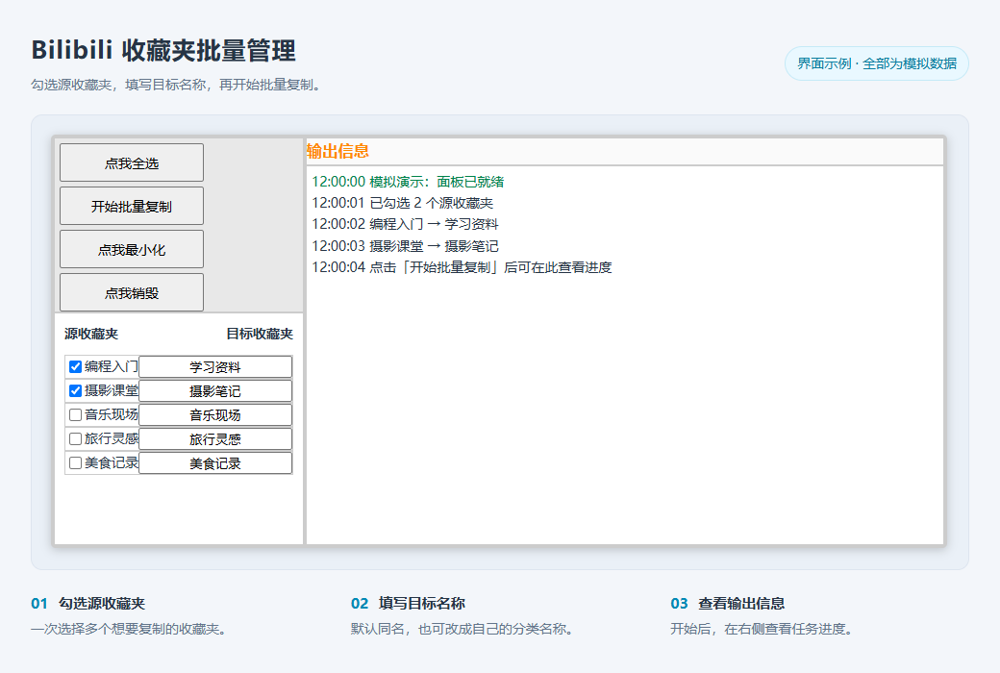

# Bilibili 收藏夹批量管理工具

QQ群：[524764959（扫码加入）](docs/assets/qq-group.jpg) · 邮箱：[ljx.1024@outlook.com](mailto:ljx.1024@outlook.com)

使用 QQ 扫码加入，点击图片可放大；也可在 QQ 搜索群号。问题反馈可提交 [GitHub Issue](https://github.com/junxian-li-hpc/bilibili-favs-manage/issues)。

批量把自己或他人公开收藏夹的视频复制到自己的收藏夹，适配旧版个人空间与新版 VUI 收藏页。

## 界面预览

图中收藏夹名称和日志均为模拟数据，由项目的实际面板组件生成。

## 安装

1. 安装并启用 [Tampermonkey（篡改猴）](https://www.tampermonkey.net/)。
2. 从 [Greasy Fork 安装脚本](https://greasyfork.org/zh-CN/scripts/487232-bilibili-%E6%94%B6%E8%97%8F%E5%A4%B9%E6%89%B9%E9%87%8F%E5%A4%8D%E5%88%B6)，确认脚本已启用。
3. 登录 B 站，打开要复制的用户空间，进入「收藏」。

仓库中的 **2.1.2 修复版尚未发布到 Greasy Fork**。如需立即使用，在 Tampermonkey 中打开已安装脚本的编辑器（或新建脚本），用 [dist/BilibiliFavsManage.user.js](dist/BilibiliFavsManage.user.js) 的全部内容替换并保存，关闭重复安装的旧版本，然后刷新收藏页。

## 使用

1. 在浮动面板左侧勾选「源收藏夹」。
2. 在右侧填写对应的「目标收藏夹」名称，默认与源收藏夹同名。
3. 点击「开始批量复制」，在面板的「输出信息」中查看进度。
4. 复制他人的收藏夹时，脚本会先前往自己的收藏页，准备目标收藏夹，再返回源页面复制。等待自动跳转和分页完成。

已有同名目标会直接复用；名称首尾空白会被去掉，内部空格保留。失败或创建结果未确认时会停止，请核对目标收藏夹的实际结果后再重试。

面板可以拖动、缩放和最小化；点击「点我销毁」后，可从 Tampermonkey 的脚本菜单选择「显示收藏夹管理面板」重新打开。

遇到不显示面板、复制失败等问题，请看 [常见问题](docs/troubleshooting.md)。

## 开发与文档

| 你想做什么 | 从这里开始 |
| --- | --- |
| 排查面板不显示、复制失败 | [常见问题](docs/troubleshooting.md) |
| 本地开发、构建脚本、运行测试 | [贡献与开发指南](CONTRIBUTING.md) |
| 了解启动检测、跨页面创建和复制流程 | [架构与流程](docs/architecture.md) |
| 适配 B 站页面改版 | [开发指南：目录与适配器](CONTRIBUTING.md#目录) |
| 更新模拟截图 | [开发指南：界面预览](CONTRIBUTING.md#界面预览) |
| 查看版本变化 | [更新日志](CHANGELOG.md) |

开发从 `src/` 开始，构建后的可安装脚本在 `dist/`。本项目使用 [MIT License](LICENSE)。
