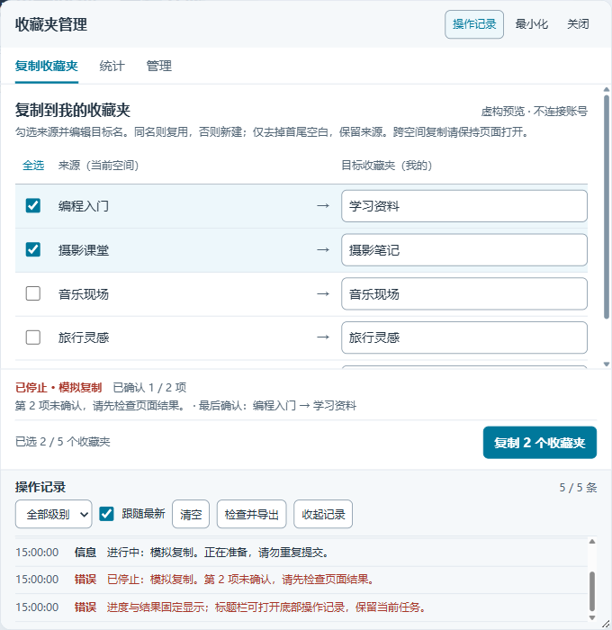
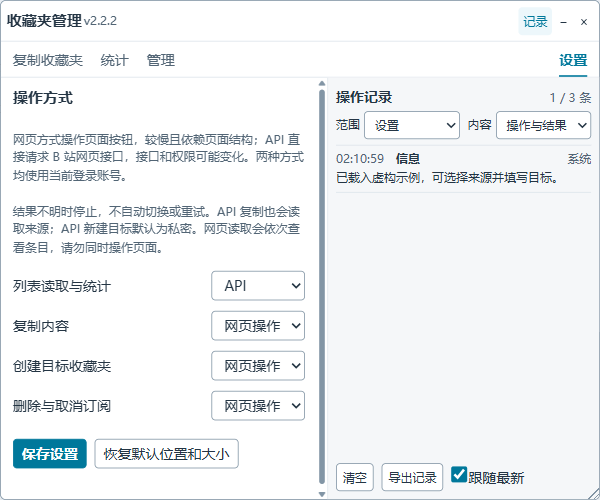
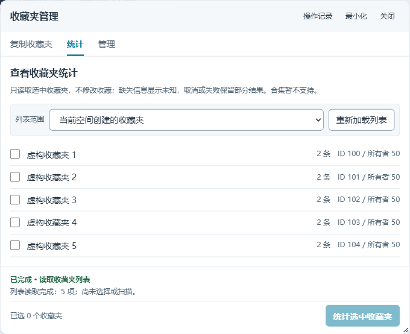
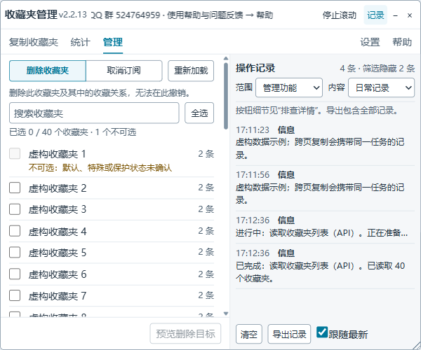

# Local management build

These capabilities are in local build **2.2.6**, visible in the panel title. Versions use ordinary numeric components. The published Greasy Fork version remains 2.1.2 until a separately reviewed release.

## Copy and diagnostics

Legacy webpage creation uses the left sidebar's **新建收藏夹** and its independent form, so preparing target folders does not require videos in the current folder. The copy-dialog alternative is used only when the sidebar entry is missing; that alternative requires selectable videos. An unconfirmed sidebar submission stops preparation instead of submitting again through another entry.

The panel opens on **复制收藏夹** in a 600×500 desktop window bounded by the viewport. The left workspace is about 326px wide and records occupy the 272px side area. Select sources and edit each destination alongside it. Destinations belong to your own space: existing normalized-name folders are reused and missing folders are created. Copy preserves the source. The fixed bottom bar starts copying; a selected empty destination must be filled first. Keep the page open during cross-space navigation.

All three tasks share **搜索收藏夹**, **全选 / 取消全选**, and a selected/total count. Bulk selection affects only matching, eligible rows. Filtering preserves edits and selected items; a warning identifies selected items outside the filter, which are still included when executing. Clear the search to review them. Each task keeps independent selections. Search and selection are disabled during work.

Progress and the last confirmed step belong to the current function: switching to statistics or management shows that function's result, and returning restores the previous result. Idle and successfully loaded catalogs do not leave a permanent status bar. **待核对** means a request was submitted without observed confirmation; later items stop and you must inspect the target before another attempt. **操作记录** is visible beside the task by default; below 560px panel width it moves below the task. The header **记录** button hides or restores it by shrinking/growing the outer right or bottom edge, preserving the task area, selections and confirmation. Viewport limits take precedence. Export opens an editable review overlay: download explicitly or press Escape to return. Exported names and IDs may identify collections; edit before sharing.

**内容** has two choices: **日常记录** shows progress, results and problems; **排查详情** also shows button clicks and task/phase identifiers for troubleshooting. **范围** follows the active function; choose **全部功能** to inspect everything. The count explicitly reports records hidden by filtering; filtering never deletes records. **导出记录** always includes all retained records, regardless of filters.

Native copy waits up to 30 seconds for a fresh platform result. After 6 seconds it reports that confirmation is still pending. A success notification permits the next item; explicit rejection stops, and missing confirmation becomes **待核对**. Closing the dialog alone is insufficient confirmation. No automatic retry or transport switch occurs.

Records show local time and have their own scroll area. Both navigation handoffs take a fresh snapshot of all retained diagnostics immediately before leaving, including preparation/fallback and waiting messages; restored entries merge without duplicates and keep the same task ID. The newest 500 entries persist in sessionStorage per tab/account; older entries are removed with a visible notice. New handoffs reject a changed login account before restoring records or executing. Export schema version 2 retains ISO timestamps and context. Diagnostics cannot replay operations. Clearing records persists when storage is available; old handoffs cannot resurrect cleared entries. Closing the tab ends session retention. Storage denial/quota failure falls back to memory and navigation snapshots; manual refresh without a saved handoff can lose memory-only records. Reading earlier entries disables **跟随最新**. Each task keeps its body scroll position.

Drag only the title area, resize within the4px inner edge or the visible bottom-right grip, or minimize. The grip remains reachable at the smallest size; dragging continues over the document outside the page body. The minimize button changes its tooltip and accessible name to **恢复面板** when collapsed. Focus the title and use arrow keys to move, Shift+arrow keys to resize. Position, expanded size, records visibility and operation settings persist on this origin; a smaller viewport clamps restored geometry. Settings offers a default-size reset. **关闭** dismisses the panel; the Tampermonkey menu can reopen it. Closing is disabled during work. Console injection has no menu command; refresh/reinject to reopen.

## 设置与操作流程

**设置** is a fourth navigation panel, not a modal. It leaves title dragging and edge/keyboard resizing available. Choose and save each purpose independently:

| Purpose | Default | Choices |
| --- | --- | --- |
| List discovery and statistics | API | API / webpage |
| Copy resources | Webpage | API / webpage |
| Create destinations | Webpage | API / webpage |
| Delete and unsubscribe | Webpage | API / webpage |

Webpage mode operates native page controls; the website itself still communicates with Bilibili. API mode calls those web interfaces directly. Neither bypasses permissions or platform restrictions. API copy also reads source snapshots through API regardless of the separate statistics reader. Choices are captured for each task; changing settings preserves loaded snapshots and invalidates old management confirmation. No uncertain submission switches transports or retries automatically.

API copy resolves exact sources and existing targets, rejects ambiguous names and self-copy, snapshots complete source video lists, and copies at most20 resources per sequential batch. Missing targets use the selected creator. API-created targets are private by default; API copying is not a local video backup. Webpage creation requires your own space; when copying elsewhere, prepare destinations first or explicitly select API creation. Existing webpage-only cross-space flow still prepares targets in your own space and returns, preserving its consume-before-execute recovery. A resumed webpage task remains webpage execution even if settings changed.

Webpage list reading expands remaining-items controls and inspects route identities; it can be much slower and changes the selected folder. Avoid simultaneous page operations. Duplicate names are resolved by route ID; unknown native markup stops with guidance. Legacy native management selectors are fixture-supported only; unrecognized controls fail before submission and users may explicitly select API. Both paths retain preview, agreement and sequential stop rules for deletion/unsubscribe.

## Read-only statistics

Open **统计**, use the visible **当前空间 / 我的订阅** buttons, then **加载列表**. Nothing is selected initially. Select only the folders to inspect, then start statistics from the bottom bar. Opening a function does not start requests. This does not copy, create, delete or unsubscribe. List rows prioritize names and counts; hover a name for exact IDs/owners, also included in each checkbox's accessible name. Statistics and management share the explicitly loaded catalog, with independent selections. Changing scope or reloading clears the catalog, old results, reports and selections. Failed or cancelled loading shows the specific cause once in the current function's status.

The summary separates entries, unique video IDs, duplicate occurrences, unavailable markers and unknown identities. Duration is a subtotal of known durations for unique videos; missing values stay unknown. Each folder shows pages, loaded count, expected count and any incomplete reason. Only a completed selected-scope scan is labelled complete. Results are not an atomic snapshot or an account-wide total. Folder subscriptions and seasons are distinct supported types; unknown or unavailable entries remain disabled. Season API content currently returns one complete list; count mismatches remain partial. Webpage statistics uses visible video identifiers/durations/authors and labels absent fields unknown. Requests are sequential, paced at 400ms, bounded to 100 pages per folder and 10000 entries in a scan. Cancel stops current/future reads. Export requires a separate review/download action; nothing is uploaded.

## Delete owned folders

Open **管理**, choose **删除收藏夹** while in your own space and load the list. The first/default entry, special playlists, unknown protection or ownership, and unavailable entries remain disabled with a reason. Ordinary folders accept both the platform's boolean and older numeric flags. Checkboxes are independent of statistics. Select exact targets, preview names/IDs/owners/counts, read the consequences and tick the agreement before confirmation. Switching functions preserves selections and copy edits but invalidates destructive confirmation. Clicking the already active tab keeps confirmation. Navigation is locked while work is running. After a deletion or unsubscribe attempt, the catalog and statistics report are cleared and must be loaded again.

Deletion removes a folder and its saved references; it does not delete uploaded videos. Back up anything needed first. No undo is provided. Each item is revalidated before submission; changed names, counts, ownership or protection stop the batch for a new preview. Items run sequentially. Cancel stops subsequent items, but an already submitted request may still complete.

## Unsubscribe

Choose **取消订阅** in **管理**, then load the list. Folder subscriptions and seasons are supported. Content availability is separate from subscription membership: an unavailable season remains eligible when its exact ID, type and current-account subscription are confirmed. A missing author is displayed as unknown; conflicting identities, unknown types and unconfirmed subscriptions are excluded. API subscription evidence comes from membership in the complete authenticated collected list, not fav_state alone. Seasons use their own unsubscribe endpoint; folder and season IDs are never interchanged. Review and explicitly confirm exact IDs and known owners.

Unavailable entries can open **预览退订目标**. In webpage management mode, the preview displays the selected names/IDs and the limitation, with **前往设置** and **返回选择** actions. To proceed with already identified entries, choose **设置 → 删除与取消订阅 → API**, save, return to Management and preview again; the selection stays. If webpage reading did not obtain stable identities, explicitly choose API reading and load the list first. The current webpage exposes a native unsubscribe menu but no stable ID for its many same-name unavailable entries. This informational preview has no executable confirmation; management never matches these targets by name alone or switches to API automatically. Statistics keeps unavailable content disabled.

## Settings and same-name entries

Saving an operation method keeps already loaded lists, independent selections, filters, task scroll and existing statistics/results/export. Those are read snapshots. Future loads/scans/previews use the saved methods; saving performs no requests. Old management confirmation is invalidated, and a new preview/agreement is required. Execution still checks fresh exact identities before each item. Explicit reload, scope changes and mutation attempts retain their existing reset behavior.

Names are display labels. Statistics and management use **type + ID**, and same-name rows visibly include type, ID and owner. Filtering or reordering does not change a selected target. Ordinary same-name entries can still use webpage management when their route IDs are verified; unavailable native rows lack that evidence, so use the explicit API choice. Nothing silently switches to API or guesses by list position.

The copy form currently maps **source name → target name**. Duplicate source names are marked and disabled; duplicate destination names stop before selection/submission, including during cross-page target preparation. API copy also rejects ambiguous names, because choosing API alone does not specify which same-name ID you intend. Use unique names for the relevant source/target; other unambiguous folders can still be copied. A single unique destination can intentionally receive several different sources.

## Outcomes and limits

Each item is **已确认**, **失败**, **结果未知**, or **未提交**. API confirmation means platform code0; native management confirmation means the exact checked row disappeared with the expected list-count change on the same account/space. Refresh the platform to verify. Failure or uncertainty stops the batch. Network loss after submission is unknown, with no automatic retry. Refresh never restores a destructive queue; every operation needs a new selection and confirmation.

Local 2.2.4 passed two disposable live create/delete cycles on VUI through console injection: one API creation and one webpage creation, both deleted through the management panel using API reads and webpage writes. Independent API reads confirmed both temporary folders absent and the original folder ID set unchanged. Native menu discovery now enters the actual hover trigger for each layout; item results and failure causes are included in ordinary records and the footer. Version 2.2.5 adds synthetic regression coverage for empty legacy-page creation and unavailable-subscription preview; no additional real-account mutations were performed for that iteration.

Legacy copy confirmation recognizes the platform's `.be-toast` message `复制成功(ง •̀_•́)ง`. Successful notification ends the wait immediately; the 30-second limit only bounds missing results. Legacy toast and hover/delete-dialog fixtures cover the actual public component structure. Live copy/unsubscribe, Tampermonkey GM sandbox, automatic cross-page recovery and current legacy-page live behavior remain unverified. Earlier read-only checks matched230 subscription names across readers and one available season's66 BVIDs and49,595 known duration seconds. Platform API contracts and permissions can change.
